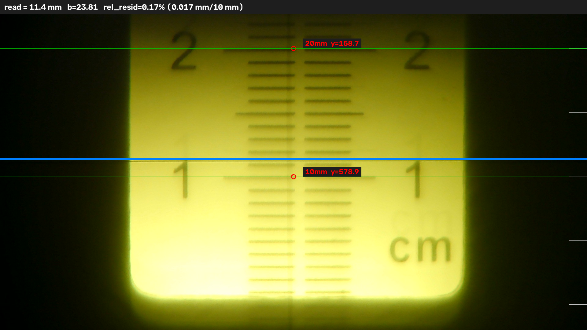

# AI 读数工具 · 杨氏模量实验望远镜标尺自动读数

拍一张望远镜视场照片，工具自动读出叉丝所在的毫米数——替代实验课上的人眼估读。

模型只负责「看见」（数字在哪、刻度线在哪、叉丝在哪），数值由几何协议算出，
并带自检：拟合不上就拒读，绝不硬报一个数。



上图：红圈是锚点（数字对应的那根刻度线），绿线是识别到的刻度线，蓝线是叉丝。
顶部黑条给出读数 `11.4 mm`、截距 `b` 与相对残差。

## 实测精度

36 张验证集（与训练集同分布、不同照片）：

| 指标 | 数值 |
|---|---|
| 有效读数 / 拒读 | 36 / 0 |
| 误差中位 | 0.050 mm |
| p95 / 最大 | 0.140 / 0.150 mm |
| 误差 ≤ 0.1 mm 占比 | 78% |
| 系统偏置 | +0.038 mm（随机抖动为主，无需补偿） |

5 张样张与人工读数逐一对照（`samples/`）：平均绝对差 **0.036 mm**，最大 0.107 mm。
人眼在标尺上估读到 0.1 mm 已是极限，本工具同一量级且可复现。

## 快速开始

需要 Python 3.10+：

```bash
pip install ultralytics          # 自动带上 torch / opencv / numpy
```

单张读数：

```bash
python read_one.py --image samples/002.jpg
```

批量（整个文件夹）：

```bash
python read_one.py --image samples/ --save-csv result.csv
```

Windows 用户可以不用命令行：把图片（或整个文件夹）**拖到 `读一张.bat` / `批量读数.bat` 上**即可，
bat 会自动找一个装好依赖的 Python。

控制台输出长这样：

```
===== 002.jpg =====
锚点 : y=578.9→10mm    y=158.7→20mm
刻度 : 158.7, 578.9  （2 条）
斜率 : k = -0.02388 mm/px  （全局）
截距 : b = 23.81 mm
残差 : 最大 0.017 mm / 跨度 10 mm = 0.17%  → 通过（上限 1.5%）
叉丝 : y = 520.5
读数 : 11.4 mm  （计算值 11.38）
可视化 : ...\vis\002.png   ← 已打开
```

批量结果写进 `result.csv`（Excel 可直接打开），每张图的可视化存进 `vis\`。

## 工作原理

望远镜成倒像，视场里的标尺是线性的，所以读数就是一次直线插值：

```
v = k·y + b
```

- `k = −0.02388 mm/px` —— 全局常量，由 180 张全量标注标定（10 mm ÷ 平均刻度间距 419 px）。
  负号必须保留：y 增大刻度值减小。
- `b` —— 每张图单独拟合：检测模型认出数字 10/20/30/40/50，锚点取**数字对应刻度线**的 y，
  姿态模型给出刻度线与叉丝的 y。有了两对 `(y, v)` 就能解出 b，叉丝代入即得读数。

**为什么拒读而不是硬报**：拟合出的残差反映锚点之间的一致性。判据用相对量
`最大残差 / 锚点跨度 ≤ 1.5%`——绝对毫米数会随量程线性放大（同一 1% 的比例误差，
10 mm 跨度是 0.10 mm，20 mm 跨度就是 0.20 mm），用绝对阈值会把大量好图误杀。
相对残差超限、锚点不足 2 个、刻度线不足 2 条、没有叉丝，都会拒读并给出原因。

两个模型的分工：

| 模型 | 任务 | 类别 | mAP50 |
|---|---|---|---|
| `runs/det_full` | 检测 | 数字 num_1~num_5 | 0.979 |
| `runs/pose_full` | 姿态 | 刻度线 tick、叉丝 cross_h（各 2 关键点） | 0.990 |

训练数据为 180 张自采视场照片（1920×1080，144 训练 / 36 验证）。

## 参数

| 参数 | 默认 | 说明 |
|---|---|---|
| `--k` | -0.02388 | 全局斜率 mm/px，标定值，勿动 |
| `--rel-resid` | 0.015 | 相对残差上限，可收紧/放宽 |
| `--anchor` | tick | 锚点取刻度线（默认）或数字框中心 |
| `--no-show` | 关 | 不自动弹开可视化图 |
| `--no-vis` | 关 | 不画图（批量追速度） |
| `--save-csv` | 空 | 逐图结果写 CSV |
| `--det` / `--pose` | runs/... | 换权重 |

## 目录结构

```
ai-reading-tool/
├── read_one.py               # 读数主程序
├── 读一张.bat / 批量读数.bat  # Windows 双击入口（支持拖拽）
├── 使用说明.md               # 详细使用文档
├── requirements.txt
├── runs/{det_full,pose_full}/weights/best.pt   # 两个模型权重（约 11 MB）
├── samples/                  # 3 张样例照片，可直接试跑
└── docs/example_vis.png      # README 配图
```

## 已知局限

- 关键点定位抖动 3~5 px（≈0.07~0.12 mm）是当前主要误差源，提升空间在标注密度与分辨率。
- 每张图成像比例存在 ±4% 差异（拍摄距离不同），相对残差判据已把它计入。
- 部分照片锚点跨度只有 10 mm，自检自由度少；更大跨度更可靠。
- 数据集 180 张、单一实验装置，换相机/目镜需重新标定 k 并补数据重训。

## License

[MIT](LICENSE)
